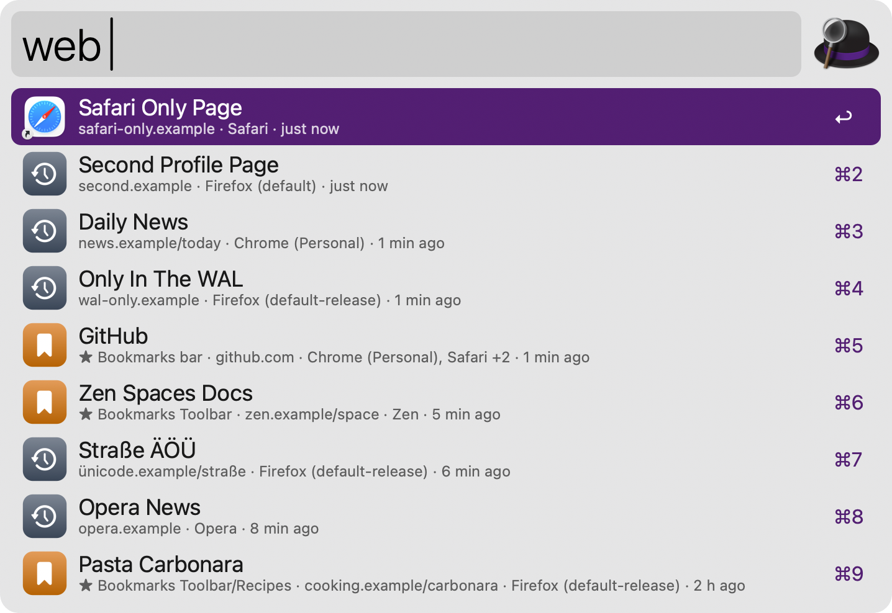
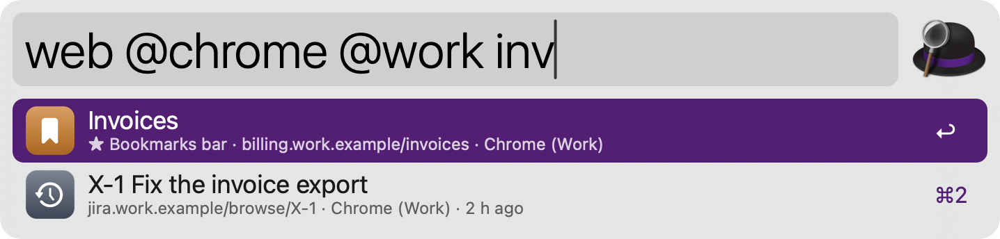
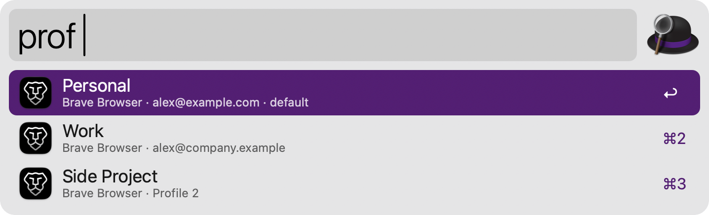
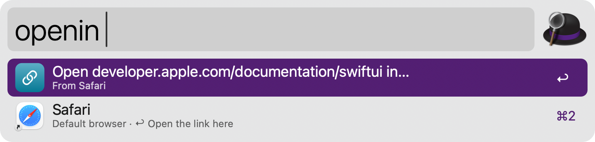
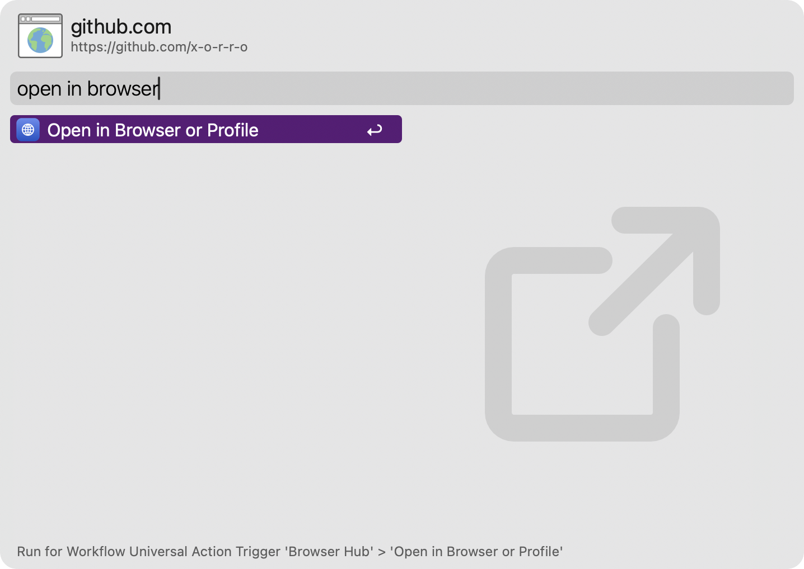
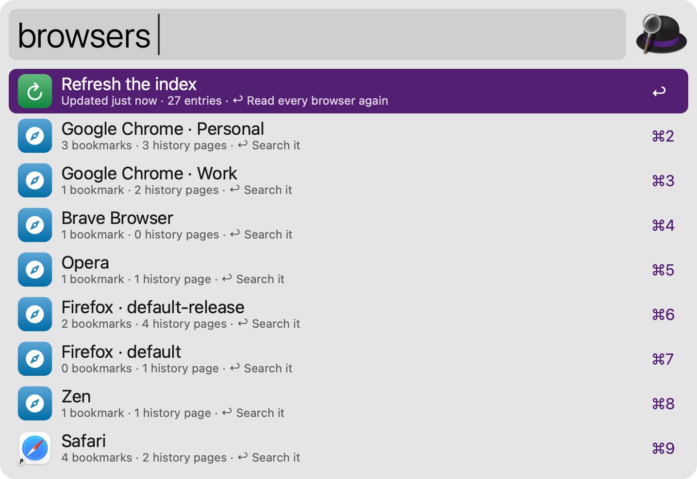

#  Browser Hub

Search the bookmarks and history of every browser and profile at once, open a browser in the right profile, and open any link in another browser. Everything stays on your Mac.

## Setup

Safari keeps its bookmarks and history in a protected folder. To include Safari, give Alfred Full Disk Access in System Settings › Privacy & Security › Full Disk Access. The other browsers need no permission.

## Usage

Search bookmarks and history of all your browsers via the `web` keyword. Chrome (every channel), Arc, Brave, Edge, Vivaldi, Opera, Dia, Comet, Helium, Firefox, Zen, LibreWolf, Floorp, Waterfox and Safari are found automatically, with all their profiles. A page saved or visited in several browsers appears once, with bookmarks ranked first. Leave the query empty to see what you visited last. Configure the Hotkey to search without typing the keyword.



Type `@` to narrow the search to one browser or profile, like `web @chrome @work invoice` or `web @safari recipes`. Search only bookmarks via the `bmk` keyword, or only history via the `webh` keyword.



* <kbd>↩</kbd> Open the page in the browser and profile it came from (or the default browser, as set in the Workflow’s Configuration).
* <kbd>⌘</kbd><kbd>↩</kbd> Open it in the default browser instead (or in its own browser).
* <kbd>⌥</kbd><kbd>↩</kbd> Choose another browser or profile to open it in.
* <kbd>⌃</kbd><kbd>↩</kbd> Copy it as a Markdown link.
* <kbd>⌘</kbd><kbd>C</kbd> Copy the URL.
* <kbd>⌘</kbd><kbd>Y</kbd> Quick Look the page.

### Profiles

List every Chrome, Arc, Brave, Edge, Vivaldi, Firefox, Zen and other profile via the `prof` keyword, with its name, account and picture. Type a URL after the name, or copy one first, to open it in a profile.



* <kbd>↩</kbd> Open the browser in that profile.
* <kbd>⌘</kbd><kbd>↩</kbd> Open the typed or copied URL in that profile.
* <kbd>⌥</kbd><kbd>↩</kbd> Open a private window of that profile.

### Open Link In

Open the current tab of the frontmost browser in another browser or profile via the `openin` keyword. When the frontmost app isn’t a browser, the copied link is used, or type one after the keyword.



Alternatively, open a selected link via the Universal Action, or configure the Hotkey to send the current tab.



* <kbd>↩</kbd> Open the link in that browser or profile.
* <kbd>⌘</kbd><kbd>↩</kbd> Open it in a private window.

### Index

Browser Hub keeps a private index of your bookmarks and history in its cache folder and refreshes it in the background while you search. Browser databases are copied before they’re read, so they can be searched while the browsers are open, and nothing is ever sent anywhere. See what’s indexed, refresh it, or clear it via the `browsers` keyword.



Leave browsers or single profiles out of the index, stop indexing history, or choose how many history pages to keep in the Workflow’s Configuration. Every keyword can be changed there too.

## Development

```bash
swift tools/make_icons.swift tools/icons.json src   # regenerate icons
python3 tools/build.py --package                     # write src/info.plist and dist/*.alfredworkflow
python3 tests/test_browserhub.py                     # run the tests
```

## AI disclosure

This workflow was developed with the help of Claude (Anthropic), an AI assistant. The code is reviewed and tested by the author.
